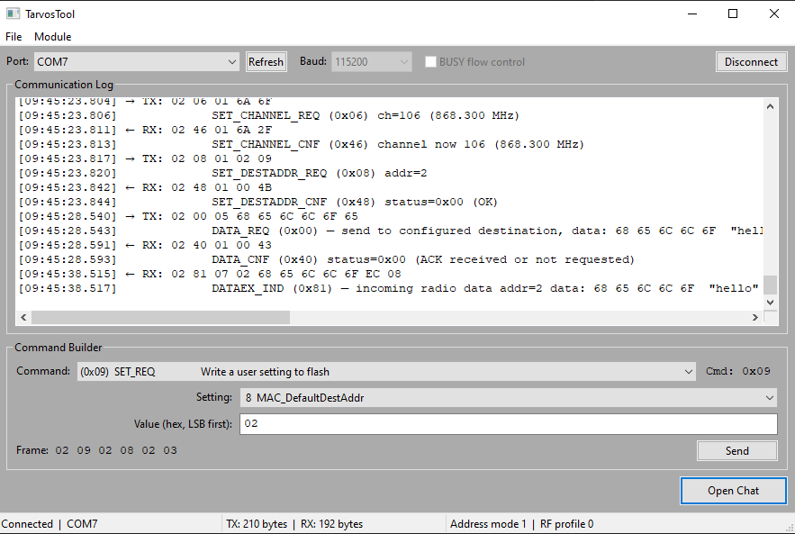
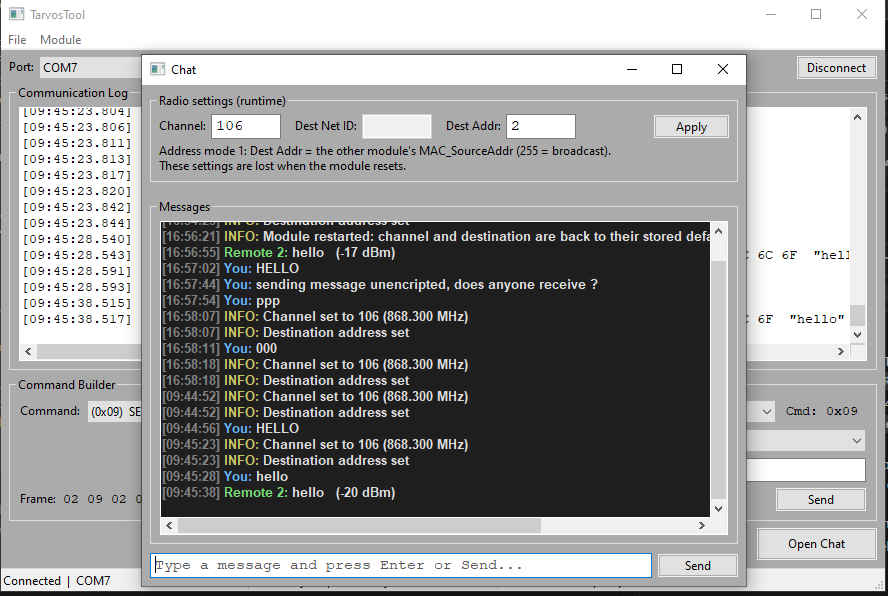
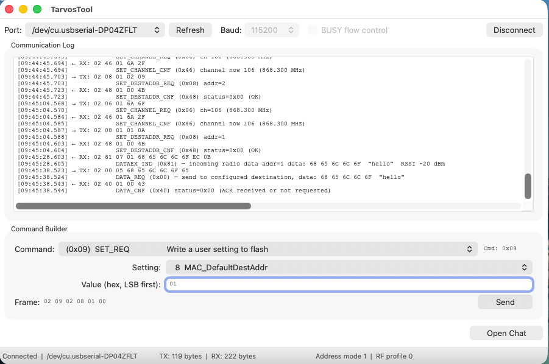
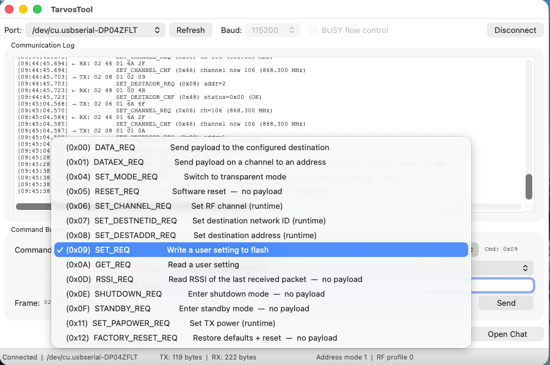

# TarvosTool

A macOS and Windows desktop tool for talking to **Würth Elektronik Tarvos-e** radio modules over a USB serial connection (FTDI VCP → UART). Use it to:

- send any of the module's documented commands from a **Command Builder**, with a live preview of the exact bytes on the wire,
- watch every transmitted and received frame in a decoded **Communication Log**,
- **chat** in plain text between two modules, and
- run **several modules at once**, one window per device.

It speaks the module's binary WE-ProWare serial protocol. Built with C++17 and wxWidgets.

> TarvosTool is an independent community project. It is not affiliated with or endorsed by Würth Elektronik.

---

## Screenshots



*Main window on Windows: the Communication Log shows each frame with a decoded description, and the Command Builder previews the bytes before they are sent.*



*The chat window, with the runtime radio settings (channel and destination) above the conversation.*



*The same tool on macOS. The Command Builder is set up to write `MAC_DefaultDestAddr`.*



*All request commands are available in the Command Builder.*

---

## Requirements

| | macOS | Windows |
|---|---|---|
| OS | Apple Silicon or Intel | Windows 10 / 11, 64-bit |
| Compiler | Xcode Command Line Tools: `xcode-select --install` | Visual Studio 2022 (Desktop development with C++) |
| Build tools | `brew install cmake wxwidgets` | CMake and [vcpkg](https://vcpkg.io) |
| USB driver | [FTDI VCP driver](https://ftdichip.com/drivers/vcp-drivers/) for FTDI boards, then reboot | same (Windows usually installs it automatically) |

You also need a Tarvos-e module or EV-kit connected over USB.

---

## Build and run

### macOS

```bash
git clone https://github.com/fsm-fawzifansa/TarvosTool.git
cd TarvosTool
mkdir build && cd build
cmake .. -DCMAKE_BUILD_TYPE=Release
make -j$(sysctl -n hw.logicalcpu)
open TarvosTool.app
```

The build targets arm64 by default. For an Intel Mac, add `-DCMAKE_OSX_ARCHITECTURES=x86_64`.

### Windows

In a Developer PowerShell for Visual Studio:

```powershell
git clone https://github.com/fsm-fawzifansa/TarvosTool.git
cd TarvosTool
vcpkg install wxwidgets:x64-windows
cmake -S . -B build -DCMAKE_TOOLCHAIN_FILE="<path-to-vcpkg>/scripts/buildsystems/vcpkg.cmake"
cmake --build build --config Release
.\build\Release\TarvosTool.exe
```

### VS Code

Open the folder and press **⌘⇧B** (macOS) to configure and build. IntelliSense reads `compile_commands.json`, which the first build generates in the project root. If you see squiggles before that, run **C/C++: Reset IntelliSense Database** after building.

---

## Usage

### 1. Connect a module

1. Plug in the module.
   - **macOS:** check that its port exists with `ls /dev/cu.*`. Always use the `cu.*` node, not `tty.*`. The `tty.*` node waits for a carrier signal and will not work for host-initiated communication.
   - **Windows:** the module shows up as a COM port (for example `COM3`) in Device Manager under *Ports (COM & LPT)*.
2. In TarvosTool click **Refresh**, pick the port, leave the baud rate at **115200** (the factory default) unless you changed `UART_Baudrate`, and click **Connect**.
3. Optional: tick **BUSY flow control** before connecting if your board routes the module's BUSY pin to the adapter's CTS line. The tool then holds back each byte while the module is busy, as the manual requires. If BUSY is not wired to CTS, every write fails, so leave it off in that case.

On connect the tool reads the module's address mode and RF profile (`GET_REQ` 4 and 1). The status bar shows them next to the connection state and TX/RX byte counters. You can read them again with **Module → Read Address Mode & RF Profile**.

### 2. Send commands

Pick a command in the **Command Builder**. The parameter fields change to match it, and the exact frame that will be sent is previewed before you press **Send**. Values are hex bytes, for example `48 65 6C 6C 6F`. If an input is invalid, the preview shows why instead of a frame.

Sent frames (`→ TX`) and received frames (`← RX`) appear in the log, each followed by a decoded description. For example, `RESET_REQ` transmits `02 05 00 07`; the module answers with `RESET_CNF` and then `RESET_IND` once it is ready again.

The tool follows the manual's rules for the command interface:

- **One request at a time.** Requests are queued and each waits for its confirmation (up to 500 ms, 2 s for data) before the next one is sent.
- **Address-dependent formats.** `DATAEX_REQ`, `SET_DESTNETID_REQ`, `SET_DESTADDR_REQ` and incoming `DATAEX_IND` frames are built and decoded for the module's address mode.
- **User settings.** `SET_REQ` and `GET_REQ` use a list of the settings from the manual. Values are checked for size and range before sending, because the module itself does not check them and a wrong value can make it unreachable. Each `SET_REQ` asks for confirmation, since it writes flash (about 100,000 cycles). The new value applies after a reset; until then only `SET_REQ`, `GET_REQ` and `RESET_REQ` are allowed.
- **Runtime settings.** `SET_CHANNEL_REQ`, `SET_DESTNETID_REQ`, `SET_DESTADDR_REQ` and `SET_PAPOWER_REQ` change volatile settings only. They are lost when the module resets.
- **Transparent mode.** `SET_MODE_REQ` switches to transparent mode, where the module forwards raw UART data over the radio and no longer accepts commands. Received data is then shown raw. **Module → Return to Command Mode (+++)** sends the escape sequence to come back.
- **Low-power modes.** After `SHUTDOWN_REQ` or `STANDBY_REQ` the module's UART is off until a falling edge on its WAKE_UP pin (the WAKE UP button on the EV-kit).

### 3. Chat between two modules

With factory settings both modules are in address mode 0 on channel 106, where every message is a broadcast. In that case chat works without any setup.

1. Connect each module in its own window (see below).
2. Click **Open Chat** in both windows.
3. Optional: set the radio settings in each chat window and press **Apply**. These are runtime settings and are lost when the module resets.
   - **Channel** (0 to 140): must be the same on both modules.
   - **Dest Net ID** (address modes 2 and 3): the other module's `MAC_SourceNetID`.
   - **Dest Addr** (address modes 1 to 3): the other module's `MAC_SourceAddr`. Read it with `GET_REQ` → `MAC_SourceAddr`.
4. Type a message and press **Enter**. It is sent with `DATA_REQ`. The other window shows it with the sender's address (if the address mode has one) and the signal strength. If the module reports a failure, such as no ACK or channel busy, the chat shows it. The maximum message length depends on the RF profile: 128 bytes for profiles 0 and 2, 64 for profile 4, 224 for profile 5.

### 4. Several modules at once

**File → New Window** (⌘N) opens another window with its own serial connection and protocol parser. Open one per module.

---

## Supported commands

Frame layout (WE-ProWare):

```
[STX=0x02] [CMD] [LEN] [PAYLOAD ...] [CS]
```

`LEN` is the payload length in bytes (1 byte). `CS` is the XOR of every preceding byte. A confirmation code is the request code `| 0x40` (`DATAEX_REQ` is confirmed by `DATA_CNF`), and an indication code is the request code `| 0x80`.

| CMD  | Request           | Confirmation           | Purpose                                         |
|------|-------------------|------------------------|-------------------------------------------------|
| 0x00 | DATA_REQ          | DATA_CNF (0x40)        | Send data to the configured destination         |
| 0x01 | DATAEX_REQ        | DATA_CNF (0x40)        | Send data on a given channel to a given address |
| 0x04 | SET_MODE_REQ      | SET_MODE_CNF (0x44)    | Switch to transparent mode                      |
| 0x05 | RESET_REQ         | RESET_CNF (0x45)       | Software reset                                  |
| 0x06 | SET_CHANNEL_REQ   | SET_CHANNEL_CNF (0x46) | Set RF channel (runtime)                        |
| 0x07 | SET_DESTNETID_REQ | SET_DESTNETID_CNF (0x47) | Set destination network ID (runtime)          |
| 0x08 | SET_DESTADDR_REQ  | SET_DESTADDR_CNF (0x48) | Set destination address (runtime)              |
| 0x09 | SET_REQ           | SET_CNF (0x49)         | Write a user setting to flash                   |
| 0x0A | GET_REQ           | GET_CNF (0x4A)         | Read a user setting                             |
| 0x0D | RSSI_REQ          | RSSI_CNF (0x4D)        | RSSI of the last received packet                |
| 0x0E | SHUTDOWN_REQ      | SHUTDOWN_CNF (0x4E)    | Enter shutdown mode                             |
| 0x0F | STANDBY_REQ       | STANDBY_CNF (0x4F)     | Enter standby mode                              |
| 0x11 | SET_PAPOWER_REQ   | SET_PAPOWER_CNF (0x51) | Set TX power (runtime)                          |
| 0x12 | FACTORY_RESET_REQ | FACTORY_RESET_CNF (0x52) | Restore defaults and reset                    |

Indications the tool decodes: `REPEAT_IND` (0x80), `DATAEX_IND` (0x81, incoming radio data with sender address and RSSI), `RESET_IND` (0x85), `STANDBY_IND` (0x8F, woke up from standby) and `DUTYCYCLE_IND` (0x90, enabled through `CfgFlags`).

All user settings from chapter 8 of the manual are available in `SET_REQ` / `GET_REQ`, from `UART_Baudrate` (0) to `FirmwareVersion` (33). Values read with `GET_REQ` are decoded, for example the channel as a frequency or the firmware version as `major.minor.patch`.

The protocol follows the Tarvos-e user manual v2.18. Check the manual for your firmware version before changing settings.

---

## Project structure

```
TarvosTool/
├── CMakeLists.txt
├── LICENSE
├── .github/workflows/       CI build for macOS and Windows
├── include/
│   ├── SerialPort.h         serial port (POSIX cu.* / Win32 COM, 8N1)
│   ├── TarvosProtocol.h     frame builder, parser, commands, user settings
│   ├── MainFrame.h          main window: connection, log, command builder
│   └── ChatFrame.h          chat window
└── src/
    ├── main.cpp             wxApp entry point
    ├── SerialPort.cpp
    ├── TarvosProtocol.cpp
    ├── MainFrame.cpp
    └── ChatFrame.cpp
```

Command codes, the user settings table and frame decoding are in `TarvosProtocol`. The Command Builder's table of commands and their inputs is at the top of `src/MainFrame.cpp`.

---

## License

Released under the [MIT License](LICENSE). You are free to use, modify and distribute this software, including in your own projects, as long as you keep the copyright notice and license text, which credits **Fawzi Fansa** as the original author.
